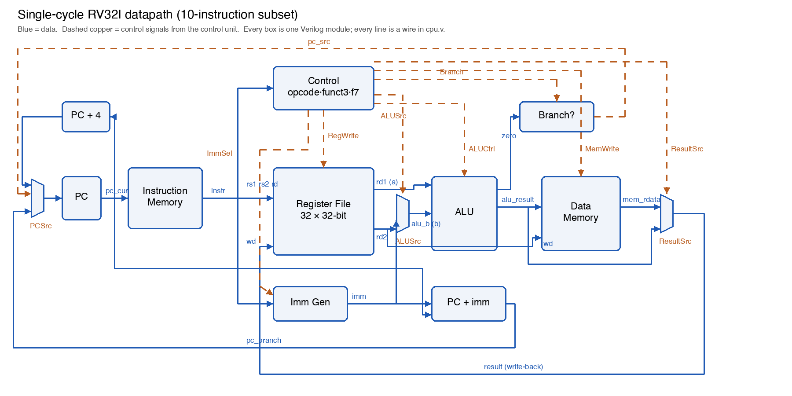

# Single-Cycle RV32I Processor (Verilog)

MCA course project, Project 1. A single-cycle RISC-V processor that executes
ADD, SUB, AND, OR, XOR, ADDI, LW, SW, BEQ and BNE.

## Team

| Member   | Name | Part                                   |
|----------|------|----------------------------------------|
| Member 1 |      | PC, top-level integration, diagram     |
| Member 2 |      | ALU + testbench                        |
| Member 3 |      | Register file, immediate generator     |
| Member 4 |      | Control unit + truth table             |
| Member 5 |      | Memories, test programs, CPU testbench |

## Demo video

<paste YouTube / Drive link>

## Report

[report/report.pdf](report/report.pdf)

## Architecture



## Repository layout

```
rtl/        hardware modules   (pc.v cpu.v alu.v regfile.v immgen.v control.v imem.v dmem.v)
tb/         testbenches        (tb_alu.v tb_regfile.v tb_control.v tb_cpu.v)
programs/   test programs      (test_all.s/.hex, sum_loop.s/.hex)
sim/        run simulations here (outputs are not committed)
docs/       datapath diagram, control table, waveform screenshots
report/     report.pdf + video link
```

## Interface contract

Every module keeps these exact port names and widths. `cpu.v` connects to them.

| Module  | Owner | Inputs                                        | Outputs                                                                  |
|---------|-------|-----------------------------------------------|--------------------------------------------------------------------------|
| pc      | M1    | clk, reset, pc_next[31:0]                     | pc[31:0]                                                                 |
| alu     | M2    | a[31:0], b[31:0], alu_ctrl[2:0]               | result[31:0], zero                                                       |
| regfile | M3    | clk, we, rs1[4:0], rs2[4:0], rd[4:0], wd[31:0] | rd1[31:0], rd2[31:0]                                                    |
| immgen  | M3    | instr[31:0], imm_sel[1:0]                     | imm[31:0]                                                                |
| control | M4    | opcode[6:0], funct3[2:0], funct7_5            | reg_write, alu_src, mem_write, result_src, branch, imm_sel[1:0], alu_ctrl[2:0] |
| imem    | M5    | addr[31:0]                                    | instr[31:0]                                                              |
| dmem    | M5    | clk, we, addr[31:0], wd[31:0]                 | rd[31:0]                                                                 |

Shared codes: `alu_ctrl` 000 add · 001 sub · 010 and · 011 or · 100 xor.
`imm_sel` 00 I-type · 01 S-type · 10 B-type.

## How to run

```
cd sim
cp ../programs/test_all.hex program.hex
iverilog -o cpu_sim ../tb/tb_cpu.v ../rtl/*.v
vvp cpu_sim
gtkwave cpu.vcd
```

## Git workflow

```
git pull --rebase        # get teammates' work first
git add rtl/<your_file>  # only YOUR files
git commit -m "ALU: add ADD and SUB operations"
git push
```

## Status

- [ ] All modules implemented
- [ ] Unit testbenches passing
- [ ] Program A passes on the full CPU
- [ ] Synthesis results (Phase II)
